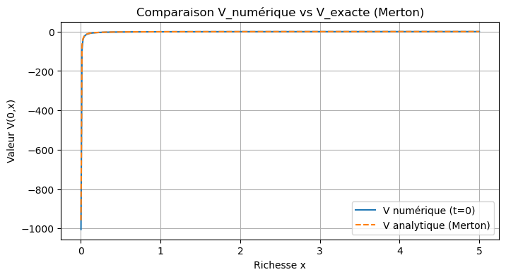
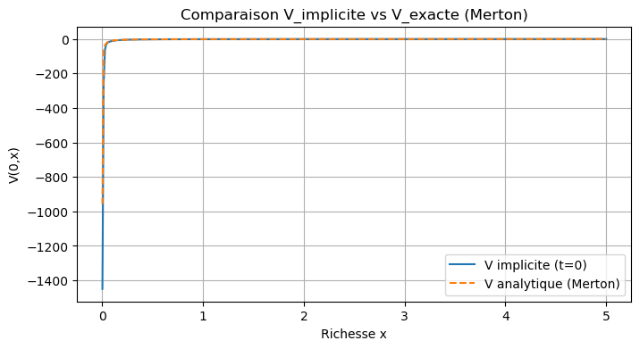
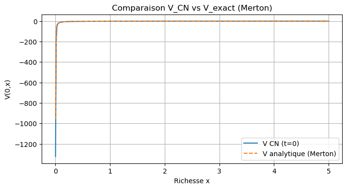
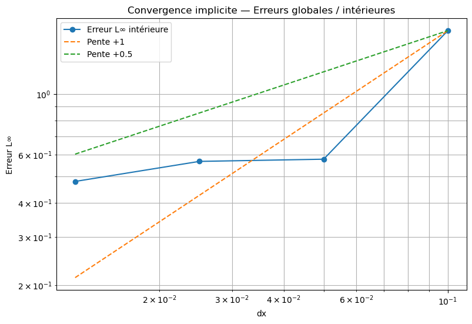

# Optimisation de portefeuille — Équation HJB (modèle de Merton)

Résolution numérique de l'**équation de Hamilton–Jacobi–Bellman** associée au problème de Merton (allocation optimale entre un actif sans risque et un actif risqué), puis validation contre la solution analytique.

> Projet académique — INSA Rouen Normandie (2025–2026) · Python (NumPy, Matplotlib)

## Le problème

Un investisseur répartit sa richesse *x* entre un actif sans risque (taux *r*) et un actif risqué (drift μ, volatilité σ). Il choisit la proportion π investie dans l'actif risqué pour maximiser l'utilité espérée de sa richesse finale, E[U(X_T)].

Par programmation dynamique, la fonction valeur V(t, x) vérifie l'équation HJB :

∂V/∂t + sup_π { (r + π(μ − r))·x·∂V/∂x + ½·π²·σ²·x²·∂²V/∂x² } = 0,  avec V(T, x) = U(x)

Pour une utilité CRRA U(x) = x^(1−γ)/(1−γ), la solution est connue explicitement et la stratégie optimale est constante :

π* = (μ − r) / (γ·σ²)  → avec μ = 8 %, r = 2 %, σ = 20 %, γ = 2 : **π* = 0,75**

## Méthodes numériques

| Schéma | Principe |
|---|---|
| **Explicite** | Résolution rétrograde en temps, dérivées centrées, contrôle optimal calculé à chaque pas |
| **Implicite (Euler arrière)** | Itération de Howard (alternance calcul du contrôle / résolution linéaire), décentrage upwind, solveur tridiagonal |
| **Semi-implicite (Crank–Nicolson)** | Diffusion traitée en Crank–Nicolson, contrôle mis à jour explicitement |

Grille : richesse x ∈ [0,001 ; 5], Nx = 400 points, Nt = 200 pas de temps, horizon T = 1 an.

## Résultats

**Fonction valeur** : les trois schémas reproduisent la solution analytique de Merton.

| Schéma explicite | Schéma implicite (Howard) | Crank–Nicolson |
|---|---|---|
|  |  |  |

**Étude de convergence** : erreur L∞ mesurée à l'intérieur du domaine (5 % exclus de chaque côté pour écarter les effets de bord), pour dx allant de 0,1 à 0,0125.



**Analyses complémentaires** (dans le notebook) :
- sensibilité de l'erreur aux paramètres financiers (r, μ, σ, γ) et au maillage (Nx, Nt) ;
- généralisation à d'autres fonctions d'utilité (quadratique, logarithmique, racine carrée), avec convergence vers une solution de référence fine.

## Limites observées

- **Singularité en x → 0** : avec γ = 2, l'utilité tend vers −∞ près de zéro, ce qui dégrade l'erreur globale et ralentit la convergence observée (ordres empiriques inférieurs à 1).
- **Stratégie optimale bruitée** : la fonction valeur est bien approchée, mais le contrôle π* estimé numériquement oscille autour de la valeur théorique 0,75. Un maillage plus fin, un changement de variable (log-richesse) ou une régularisation du contrôle seraient des pistes d'amélioration.

## Lancer le notebook

```bash
pip install -r requirements.txt
jupyter notebook HJB_Merton.ipynb
```
